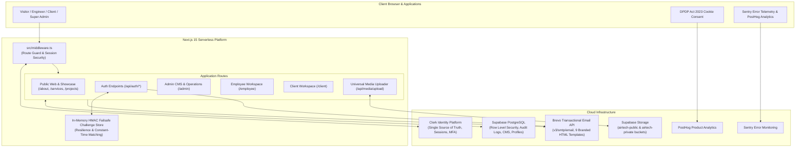

# ▲ AIRTECH — HVAC & MEP Engineering Platform

[](https://nextjs.org/)
[](https://react.dev/)
[](https://www.typescriptlang.org/)
[](https://tailwindcss.com/)
[](https://supabase.com/)
[](https://www.brevo.com/)
[](https://clerk.com/)
[](https://airtech-website-gules.vercel.app)

> **Enterprise Corporate Website, Admin Content Management System & Three Specialized Portals** for **AIRTECH — HVAC & MEP Engineering Consultancy** (Kolkata, West Bengal, India).

---

## 🌐 Live Deployments & Portal Gateways

- **Official Public Website:** [airtech-website-gules.vercel.app](https://airtech-website-gules.vercel.app/)
- **Portal Selection Hub (Panel 8):** [`/portal-access`](https://airtech-website-gules.vercel.app/portal-access)
- **👑 Owner / Super Admin Portal (Panel 15):** [`/admin`](https://airtech-website-gules.vercel.app/admin)
- **👷 Employee Engineering Portal (Panel 16):** [`/employee`](https://airtech-website-gules.vercel.app/employee)
- **🏢 Client Project Portal (Panel 17):** [`/client`](https://airtech-website-gules.vercel.app/client)
- **🔐 Password Recovery:** [`/forgot-password`](https://airtech-website-gules.vercel.app/forgot-password)

---

## 🏗️ System Architecture



---

## 🚀 Key Highlights & Capabilities

### 1. Brevo Transactional Email Engine
- **Direct Official API:** Dispatches via `POST https://api.brevo.com/v3/smtp/email` authenticated via the `api-key` header.
- **Server-Side Only:** No client-side key leakage; 10-second `AbortController` timeout; failsafe diagnostic fallbacks.
- **9 Branded HTML Templates with Plain-Text Fallback:**
  1. Registration OTP verification
  2. Login 2FA security passcodes
  3. Password recovery codes
  4. Onboarding welcome & review notice
  5. Account approval alerts
  6. Prospective client inquiry notifications (auto-acknowledgment + admin alert)
  7. Engineering candidate applications (CV link + HR alert)
  8. High-priority admin security alerts
  9. Drawing revisions & RFI status updates

### 2. Hardened Multi-Factor OTP Security
- **Cryptographically Secure:** 6-digit numeric OTP generation via Node `crypto.randomInt()`.
- **5-Minute Expiration:** All challenges expire automatically after 300 seconds (`OTP_EXPIRY_MINUTES = 5`).
- **60-Second Cooldown:** Rapid successive requests are rejected with HTTP 429 (`Please wait X seconds...`).
- **Single-Use Enforcement:** OTP tokens are immediately invalidated upon successful verification.
- **Max Attempt Limit:** Challenges are permanently invalidated after 3 failed attempts to defeat brute-force guessing.
- **Constant-Time Verification:** Compared using HMAC-SHA256 and `crypto.timingSafeEqual` to eliminate side-channel timing attacks.
- **Rolling Rate Limiting:** Capped at 5 OTP generation attempts per 15-minute window per email address.

### 3. The 17 Storyboard Panels
All 17 design panels from the master blueprint are fully implemented:
- **Panel 1:** Homepage with 3D Canvas AHU ductwork simulation & KPI ticker.
- **Panel 2:** About Us — corporate philosophy, Kolkata credentials, MEP experience.
- **Panel 3:** Services — HVAC, Fire Fighting, Plumbing, Electrical, and BMS.
- **Panel 4:** Projects / Portfolio — filterable case studies across commercial, hospitals, hospitality.
- **Panel 5:** Leadership & Advisory Board profiles.
- **Panel 6:** Careers — open engineering vacancies with CV upload.
- **Panel 7:** Contact — interactive technical consultation form.
- **Panel 8:** Portal Access Selection Hub.
- **Panel 9:** Owner Login (Step 1 credentials).
- **Panel 10:** OTP Verification (Step 2 6-digit auto-advancing boxes).
- **Panel 11:** Change Password (mandatory first-time reset).
- **Panel 12:** Registration selection (Employee vs Client).
- **Panel 13:** Employee Registration Form with department & designation.
- **Panel 14:** Registration Submitted confirmation.
- **Panel 15:** Owner / Super Admin Portal (live KPI dashboard, Website CMS, Media Library, Inquiries, Careers).
- **Panel 16:** Employee Engineering Portal (tasks, timesheets, HAP heat load calculations, drawings).
- **Panel 17:** Client Portal (active site progress bars: City Hospital 78%, Retail Mall 46%, Office Tower 92%, drawing approvals, invoices).

---

## 🛠️ Tech Stack & Dependencies

| Category | Technology |
|---|---|
| **Framework** | Next.js 15.1.7 (App Router), React 19, TypeScript 5.7 |
| **Styling & Motion** | Tailwind CSS 3.4, Framer Motion 14, Lucide React Icons |
| **3D Graphics** | Three.js (interactive duct air velocity simulation) |
| **Authentication & IAM** | Clerk (`@clerk/nextjs`), Supabase Auth, HMAC OTP tokens |
| **Database & Storage** | Supabase PostgreSQL with RLS, Supabase Storage buckets |
| **Transactional Email** | Brevo Transactional Email REST API (`v3/smtp/email`) |
| **Payment Infrastructure** | Stripe India (dual flow: card checkout + bank NEFT UTR) |
| **Monitoring & Telemetry** | Sentry (`@sentry/nextjs`), PostHog Product Analytics |
| **Hosting & CI/CD** | Vercel Serverless Platform, GitHub Actions |

---

## ⚙️ Environment Variables Setup

Create a `.env.local` file for local development or configure in **Vercel Project Settings → Environment Variables**:

```env
# Application Base URL
NEXT_PUBLIC_APP_URL=https://airtech-website-gules.vercel.app

# Brevo Transactional Email Service
BREVO_API_KEY=xkeysib-your_brevo_api_key_here
BREVO_SENDER_EMAIL=noreply@airtech.in
BREVO_SENDER_NAME=AIRTECH
ADMIN_EMAIL=bera.ankan005@gmail.com

# Clerk Authentication
NEXT_PUBLIC_CLERK_PUBLISHABLE_KEY=pk_test_...
CLERK_SECRET_KEY=sk_test_...
NEXT_PUBLIC_CLERK_SIGN_IN_URL=/owner/login
NEXT_PUBLIC_CLERK_SIGN_UP_URL=/register
NEXT_PUBLIC_CLERK_AFTER_SIGN_IN_URL=/portal-access
NEXT_PUBLIC_CLERK_AFTER_SIGN_UP_URL=/register/submitted

# Supabase Database & Private Storage
NEXT_PUBLIC_SUPABASE_URL=https://your-project-id.supabase.co
NEXT_PUBLIC_SUPABASE_ANON_KEY=eyJhbGci...
SUPABASE_SERVICE_ROLE_KEY=eyJhbGci...

# Monitoring & Analytics
NEXT_PUBLIC_SENTRY_DSN=https://...
NEXT_PUBLIC_POSTHOG_KEY=phc_...
NEXT_PUBLIC_POSTHOG_HOST=https://app.posthog.com
```

---

## 💻 Local Development

```bash
# Clone the repository
git clone https://github.com/AnkanBera05/airtech-website.git
cd airtech-website

# Install dependencies
npm install

# Run development server
npm run dev

# Run production build & verify
npm run build
npm start
```

---

## 👤 Author & Maintainer

**Ankan Bera**  
- **GitHub:** [@AnkanBera05](https://github.com/AnkanBera05)  
- **Repository:** [AnkanBera05/airtech-website](https://github.com/AnkanBera05/airtech-website)  
- **Project:** AIRTECH — HVAC & MEP Engineering Consultancy

---

## 📄 License

Proprietary enterprise software built for **AIRTECH Engineering Consultancy**. All rights reserved.
